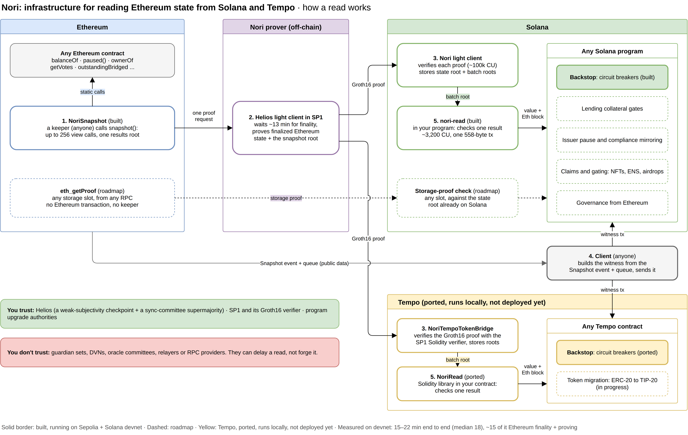

# Nori: World's Fair submission

Read Ethereum state from any Solana program, proven instead of relayed.



## Where it stands (8 Oct)

- **Live on real Nori proofs**, Ethereum Sepolia → Solana devnet, since 7 Oct.
- **10-hour soak:** 39 of 39 snapshots proven and applied; a read reaches Solana a median
  18 min after its Ethereum block (15–22), almost all of it Ethereum finality. An untouched
  guard stayed HEALTHY all night.
- **Drain demo:** draining the lockbox trips the guard; a refill doesn't reset it; the
  admin's `unlatch` does, once the backing is back (a testing and demo shortcut: one key;
  production needs a timelock or governance, on the roadmap).
- **Apps:** a live bridge dashboard and a prove-balance app in the browser ([web/](web/README.md)).
- **Next:** Ethereum + Solana mainnet, once Nori proves mainnet.

Addresses and numbers: [docs/README.md](docs/README.md).

## Repo

| Path            | What                                                                                                                                                                      |
| --------------- | ------------------------------------------------------------------------------------------------------------------------------------------------------------------------- |
| `ethereum/`     | `NoriSnapshot` contract, query list, deploy and snapshot tasks                                                                                                            |
| `nori-read/`    | Rust crate: verify a snapshot result on Solana in one call ([README](nori-read/README.md))                                                                                |
| `programs/`     | Solana programs: `nori-read-example`, [`backstop`](programs/backstop) (circuit breaker)                                                                                   |
| `client/`       | Sample TS client and keeper CLI: create-guards, snapshot, checkpoint, submit, status, assert, unlatch, run                                                                |
| `web/`          | Browser apps: prove an Ethereum balance on Solana, and a live dashboard of the proof queue and read latency ([README](web/README.md))                                     |
| `test-vectors/` | Test data shared by the TS and Rust tests                                                                                                                                 |
| `test-harness/` | Surfpool helpers for the program tests                                                                                                                                    |
| `scripts/`      | `dry-run.sh` (the whole loop locally), `deploy-devnet.sh` (programs + demo mint), `soak.sh` (keeper for hours, then a report), `replay-wormhole.sh` (Wormhole 2022, live) |
| `docs/`         | [Index of all docs](docs/README.md), diagrams, test deployments                                                                                                           |

## Run

```sh
git clone https://github.com/Nori-zk/nori-worldsfair-submission
npm install && npm run build
npm test                 # ethereum contracts, then the client
npm run lint             # every workspace
cargo test --locked -p nori-read  # Solana-side verification
scripts/dry-run.sh       # the whole loop on local chains, with a fake prover
```

Validator tests and toolchain notes: [AGENTS.md](AGENTS.md).
The Nori SDK comes from npm (`@nori-zk/nori-bridge-solana-sdk` and friends) and,
for Rust, a cargo git dependency, both pinned to one sdk release; TypeScript needs no Rust.

## Apps

Browser apps on Sepolia + Solana devnet ([web/README.md](web/README.md)):

```sh
npm run dev -w web/apps/prove-balance   # prove an address's ETH or token balance on Solana: http://localhost:5180
npm run dev -w web/apps/guard-status    # each Backstop guard in plain words: http://localhost:5181
npm run dev -w web/apps/proven-facts    # what NoriSnapshot read on Ethereum, proven on Solana: http://localhost:5182
npm run dev -w web/dashboards/bridge    # every proof request from Ethereum to Solana, live: http://localhost:7400
```

## Deploy (Sepolia + Solana devnet)

Keys and addresses live in one `.env`: `cp .env.example .env`, then fill it in.

```sh
# Ethereum: NoriSnapshot on the existing queue, and a demo lockbox
npm run deploy -w ethereum                     # -> ethereum/.env.nori-eth-snapshot
npm run deploy-demo -w ethereum -- 116723.52   # -> ethereum/.env.nori-eth-demo

# Solana: Backstop, nori-read-example, and a demo mint of 116,700 (-> .env.nori-sol-demo); safe to rerun
scripts/deploy-devnet.sh

# Keeper: client/keeper.demo.json reads .env and the deploy outputs
npm run keeper -w client -- create-guards
npm run keeper -w client -- status   # Nori's progress through the queue, then each guard
npm run keeper -w client -- run      # snapshots on the heartbeat and as soon as a watched result changes
npm run keeper -w client -- assert   # each guard's assert_healthy, as a lender calls it (--send lands it)
npm run keeper -w client -- verify <snapshot tx>   # nori-read-example verifies each result, on-chain
```

bridge-head proves `NORI_ETH_PROOF_QUEUE_ADDRESS` and updates `NORI_SOL_TOKEN_PROGRAM_ID`.
Create guards only after that program is initialized: a guard pins it.

## Built vs roadmap

|                                                                                          | Status                                                                                                             |
| ---------------------------------------------------------------------------------------- | ------------------------------------------------------------------------------------------------------------------ |
| NoriSnapshot (batched reads) and `nori-read`                                             | Built                                                                                                              |
| Backstop guards: trip rule, latch, paused-at-source, stale, `assert_healthy` for lenders | Built                                                                                                              |
| Keeper, local dry run                                                                    | Built                                                                                                              |
| Browser apps: prove a balance, bridge dashboard                                          | Built (Sepolia + Solana devnet)                                                                                    |
| Live loop on Sepolia + Solana devnet                                                     | Running on real proofs since 7 Oct ([results](docs/README.md#test-deployments-sepolia--solana-devnet-68-oct-2026)) |
| `enforce`: pause a Token-2022 mint when its guard trips                                  | Roadmap                                                                                                            |
| Separate warn tolerance (in-flight transfers) from the trip tolerance                    | Roadmap (one `tolerance` today)                                                                                    |
| Auto-unlatch for Solana-only custody; timelocked admin `unlatch`                         | Roadmap (admin `unlatch` today)                                                                                    |
| Check the Solana mint's authority is the expected bridge                                 | Roadmap                                                                                                            |
| Direct storage proofs: any slot, no Ethereum transaction                                 | Roadmap                                                                                                            |

Direct proofs work because each Nori update already puts Ethereum's state
root on Solana. The hackathon build uses snapshots through the existing proof queue.
