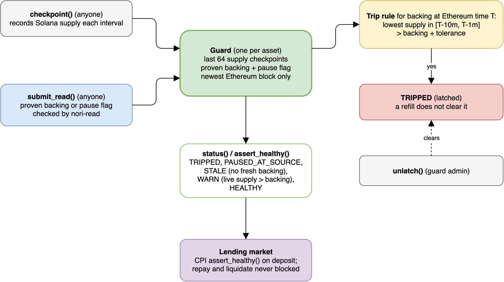

# Backstop

A circuit breaker for one bridged asset: a guard compares its Ethereum backing, proven through Nori, with its Solana supply.



| Instruction                  | Who                       | Does                                                                     |
| ---------------------------- | ------------------------- | ------------------------------------------------------------------------ |
| `create_guard(config)`       | anyone (becomes admin)    | Pins the mint, Nori program, NoriSnapshot, and backing and pause queries |
| `checkpoint`                 | anyone, once per interval | Records the mint's supply (the last 64 are kept)                         |
| `submit_read(kind, witness)` | anyone                    | Applies a proven backing or pause flag (newer blocks only)               |
| `status` / `assert_healthy`  | lenders, via CPI          | Return the status, or fail unless it is HEALTHY                          |
| `unlatch`                    | admin                     | Clears a trip                                                            |

`submit_read` costs ~17.6k compute units (541-byte transaction).

```sh
cargo test -p backstop --lib   # the rules: drain, refill, in-flight, burn-unlock, forged mint, stale
cargo test -p backstop         # Kelp replay on surfpool (cargo build-sbf first)
```
